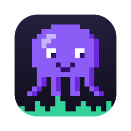
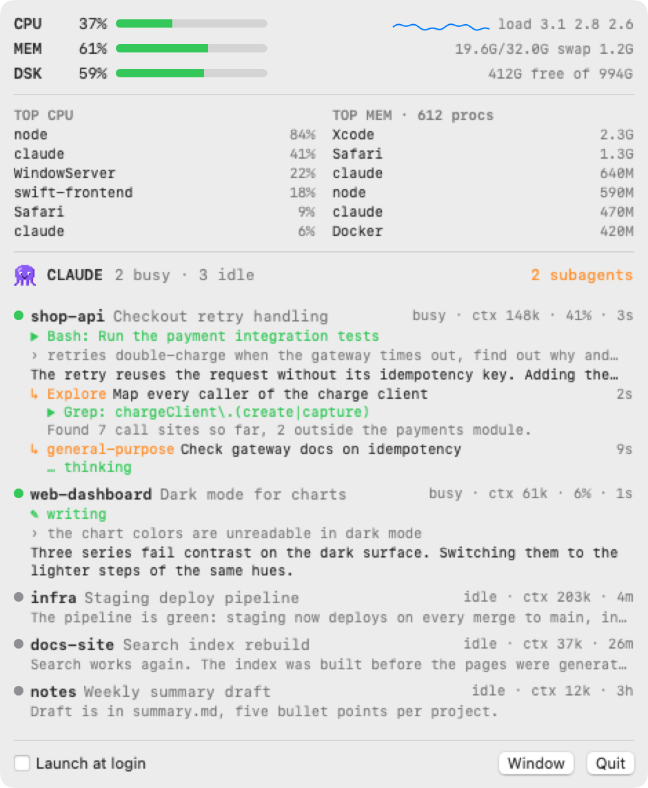
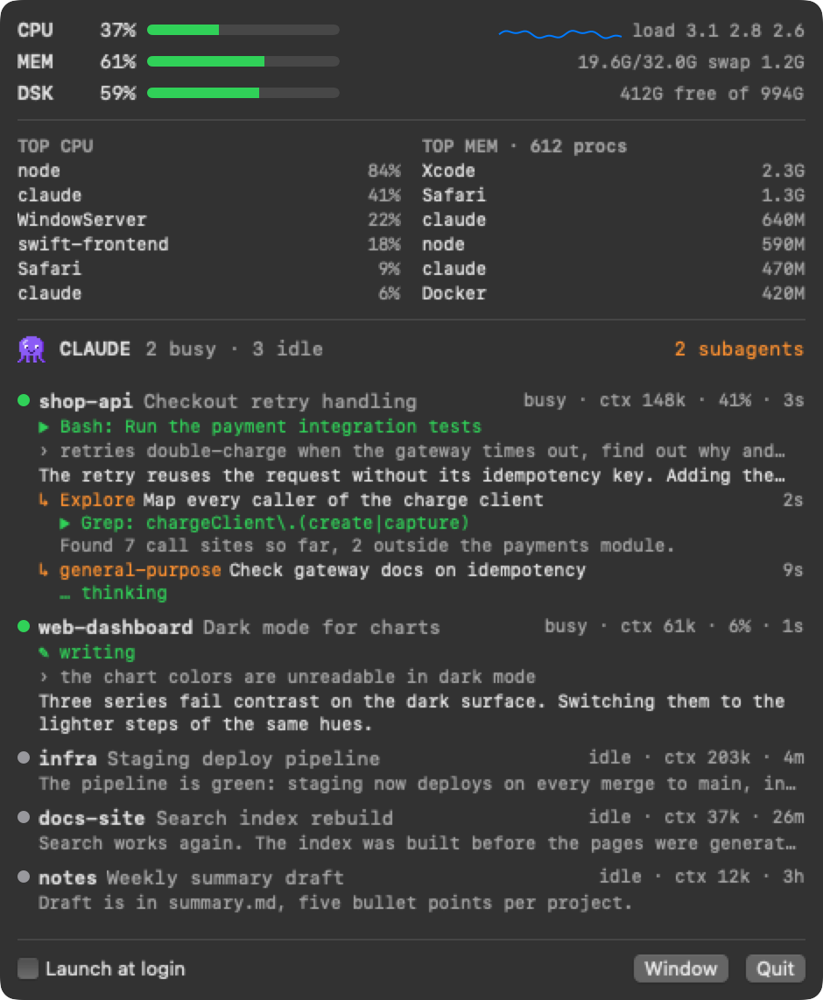

# Claude Tracker

A compact macOS menu bar app showing system stats and what the Claude Code sessions on this machine are doing.

<p>
  
  
</p>

Menu bar: `C20% M71% ✳1/7` — CPU, memory, busy/total Claude sessions. Click it for the panel:

- **System**: CPU (with a 2-minute sparkline and load average), memory and swap, disk free.
- **Processes**: top 6 by CPU and by memory.
- **Claude**: every live session with project, title, busy/idle, context size, CPU and time since last activity. Busy sessions also show the current step (tool call, thinking, writing), the last prompt and the latest assistant text. Running subagents are listed under their session.

`Window` in the footer opens the same view as a normal window. Hover a session for pid, path and model.

## Build and install

Requires Xcode command line tools (Swift 5.9+) and macOS 14+.

```sh
./scripts/build-app.sh --install   # builds, copies to /Applications, launches
```

Without `--install` it only builds `build/ClaudeTracker.app`.

## How it reads Claude sessions

Read-only, from `~/.claude`:

- `sessions/<pid>.json` — one file per session: pid, name, cwd, busy/idle. Dead pids are skipped.
- `projects/<project>/<sessionId>.jsonl` — the transcript. Only the tail is parsed, and only when the file changes.
- `projects/<project>/<sessionId>/subagents/agent-*.jsonl` and `.meta.json` — subagents. One counts as running if it wrote in the last 15 minutes and has not finished.

Transcripts do not store the text of thinking blocks, so the app shows that an agent is thinking but not what about.

## Debugging

```sh
ClaudeTracker --dump               # print one sample as text
ClaudeTracker --render panel.png   # render the panel to an image
ClaudeTracker --render panel.png --demo [--dark]   # same, with made-up data
```

The screenshots above are rendered with `--demo`, so they contain no real session data.

The octopus is pixel art defined in `Sources/ClaudeTracker/Mascot.swift`; `./scripts/make-icon.sh` regenerates the app icon from it.

## Privacy

The app only reads local files and runs `ps`. It makes no network requests and writes nothing outside its own window.

## License

[MIT](LICENSE)
